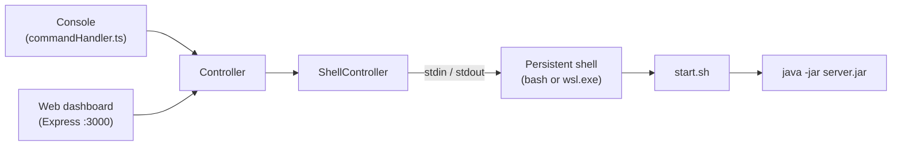
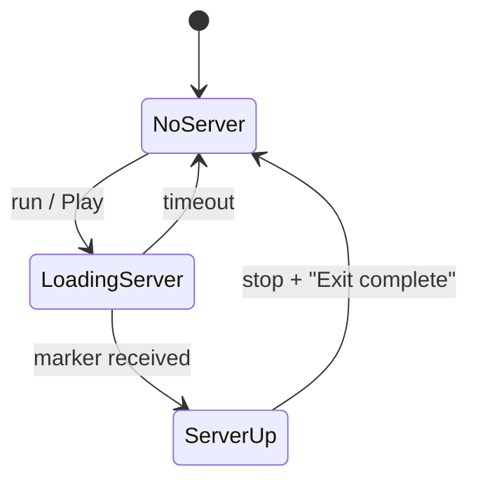

# Minecraft Server Manager

A Minecraft server manager written in TypeScript on Node.js. It lets you register several servers, start them, stop them and send them commands, both from an **interactive console** and from a **web dashboard** (Express + EJS + Tailwind CSS).

It is designed to run on **Linux** or on **Windows with WSL**. On Windows, servers run inside WSL from a Windows path (`C:\...`), which is converted to `/mnt/c/...` automatically. See [Platform setup](#platform-setup).

## Features

- Register servers (name, start script, max players, version and max boot time), interactively or from a JSON file.
- Start and stop servers with real detection of when a server is ready and when it has shut down.
- Send commands to the running server's console (`op`, `say`, `whitelist`…).
- Show the server output in the terminal whenever you need it (`redirect` / `stopredirect`).
- Web dashboard at `http://localhost:3000` with one card per server and a Play/Stop button.
- Save and load the server list as JSON.

## How it works



On startup, the manager opens **a single persistent shell** (`bash` on Linux, `wsl.exe` on Windows) and every server runs through it: the manager writes to the shell's standard input and reads its output.

- **Starting.** The manager writes the server's script path to the shell, followed by the line `say XA1231324`. The shell runs the script, the Minecraft server takes over standard input and, once it has finished loading, processes that `say` and prints `[Server] XA1231324`. As soon as that marker shows up in the output, the server is considered up. If it doesn't show up within `maxTimeToBootUp` seconds, the start is considered failed and `stop` is sent in case the server comes up late.
- **Stopping.** The manager sends `stop` (received by Minecraft) followed by `echo "Exit complete"` (run by the shell once the server has exited). When `Exit complete` is read, the server is considered stopped. The time limit is 10 seconds.
- **Commands.** `introcommand` writes straight to standard input, that is, to the Minecraft console.

Because there is only one shell, **only one server can run at a time**. The manager keeps a small state machine, which is what you see in brackets in the console prompt:



## Requirements

- Node.js 20 or later (tested with Node 22).
- Linux with bash, **or** Windows with WSL (with bash as the distribution's default shell).
- Java installed on Linux (or **inside WSL** on Windows) and the files for each Minecraft server.

## Installation

```bash
git clone https://github.com/Mario5572/minecraftServerManager.git
cd minecraftServerManager
npm install
```

Before the first run you need two files that are not in the repository, because `.gitignore` excludes them:

1. **`servers.json`** in the project root, listing your servers (see [Configuration](#configuration)). You can start from `hola.json`. Without this file, `npm run dev` fails.
2. **`tailwind.config.js`** in the project root. Without it, `npm run tw` regenerates `output.css` with no classes at all and the dashboard loses its styles:

   ```js
   /** @type {import('tailwindcss').Config} */
   export default {
     content: ["./web/public/views/**/*.ejs"],
     theme: { extend: {} },
     plugins: [],
   };
   ```

Then pick your platform (next section) and run:

```bash
npm run dev
```

This compiles the TypeScript into `dist/`, builds the Tailwind CSS, copies the views and `servers.json` into `dist/`, and starts the app: the web dashboard on port 3000 and the interactive console in the same terminal.

> Servers are **not loaded automatically** on startup. Type `load` in the console to read `servers.json`; until then the dashboard is empty.

### Platform setup

The platform is selected with two lines at the top of `src/ShellController.ts`.

**Linux:**

```ts
const isWindows = false;
let prefix = 'bash';
```

Use `bash`, not `sh`. On Debian and Ubuntu, `sh` is *dash*, which reads its input ahead and swallows the `say XA1231324` line before it reaches Minecraft, so the server start is never detected.

**Windows with WSL** (the current default in the code):

```ts
const isWindows = true;
```

The manager spawns `wsl.exe`, which opens the distribution's default shell, and converts Windows paths in `executablePath` to their WSL equivalent.

### npm scripts

| Script | What it does |
|---|---|
| `npm run dev` | Compiles, builds the CSS, copies files and starts the app |
| `npm run tw` | Builds `web/public/output.css` with Tailwind |
| `npm run copy-views` | Copies `web/public` to `dist/web/public` |
| `npm run copy-servers` | Copies `servers.json` to `dist/src/` |

## Configuration

### `servers.json`

A list of servers:

```json
[
  {
    "name": "survival",
    "maxPlayers": 10,
    "version": "1.20.1",
    "executablePath": "/home/you/servers/survival/start.sh",
    "maxTimeToBootUp": 120
  }
]
```

On Windows, use a Windows path instead, for example `"C:\\Users\\You\\Desktop\\SurvivalServer\\start.sh"`.

| Field | Description |
|---|---|
| `name` | Name used to start and stop the server. **No spaces**, because the console splits arguments on spaces. |
| `maxPlayers` | Maximum number of players (greater than 0). This is the number shown on the dashboard card. Entries with an invalid value are skipped when loading. |
| `version` | Minecraft version. Informational only. |
| `executablePath` | Path to the script that starts the server. On Linux, a regular path. On Windows, a Windows path, converted automatically to `/mnt/c/...`. |
| `maxTimeToBootUp` | Seconds to wait for the server to start. Defaults to 200 if missing. When creating a server from the console it must be between 1 and 3600. |

### The start script

`executablePath` must point to an executable script that runs the server **in the foreground** and lets it read standard input. The manager's shell opens in the project folder, so the script should first move into the server's folder:

```bash
#!/bin/bash
cd "$(dirname "$0")"
java -Xms1G -Xmx2G -jar server.jar nogui
```

Make it executable with `chmod +x start.sh` (from WSL on Windows).

## Usage

### Console

The prompt shows the current state, for example `Next Command[NoServer]:`.

| Command | Description |
|---|---|
| `help` | Shows the help. |
| `load [path]` | Loads servers from a JSON file (default `./servers.json`) and replaces the current list. |
| `save [path]` | Saves the current list to a JSON file (default `./servers.json`). |
| `list` | Lists the registered servers. |
| `create` | Creates a server by asking for its details one by one. You can drag the script into the terminal to paste its path. It is only kept if you run `save` afterwards. |
| `run <name>` | Starts a server and waits until it is ready. |
| `stop <name>` | Stops the running server. |
| `introcommand` | Asks for a command and sends it to the server console (for example `op Steve` or `say hello`). |
| `redirect` | Shows the server output in the terminal, prefixed with `out:`. |
| `stopredirect` | Stops showing it. |
| `exit` | Quits the program. |

Example session:

```text
Next Command[NoServer]: load
Next Command[NoServer]: redirect
Next Command[NoServer]: run survival
out:  [Server thread/INFO]: Starting minecraft server version 1.20.1
out:  [Server thread/INFO]: Done (12.345s)! For help, type "help"
out:  [Server thread/INFO]: [Server] XA1231324
Next Command[ServerUp]: introcommand
Enter the command to introduce: op Steve
Next Command[ServerUp]: stop survival
out:  [Server thread/INFO]: Stopping server
out:  Exit complete
Next Command[NoServer]: exit
Goodbye!
```

### Web dashboard

Open `http://localhost:3000`. Each server has a card with its name, version, max players and a button that changes with its state: **Play** (green) when it's off, **loading...** (grey) while it starts, and **Stop** (red) when it's running. The page doesn't refresh on its own: reload it to see a server go from *loading* to running.

| Route | Description |
|---|---|
| `GET /` | Dashboard with the server list and each server's state. |
| `GET /bootup/:name` | Starts booting the server and immediately replies `Server Will boot up soon`. |
| `GET /stop/:name` | Stops the server. |

## Project structure

```text
├── src/
│   ├── app.ts              # Entry point: creates the Controller, starts the web app and the console
│   ├── Controller.ts       # Server list, JSON load/save, start and stop
│   ├── ShellController.ts  # Persistent shell, state machine, start/stop detection
│   ├── minecraftServer.ts  # MinecraftServer model and validation
│   ├── commandHandler.ts   # Console command loop
│   ├── askQuestion.ts      # Terminal input helper (readline)
│   └── test.ts             # Manual child_process test (not part of the app)
├── web/
│   ├── app.mts             # Express server (port 3000)
│   └── public/
│       ├── input.css       # Tailwind input
│       ├── output.css      # Generated CSS
│       └── views/
│           ├── index.ejs                # Main page
│           └── partials/serverCard.ejs  # Card for each server
├── hola.json               # Example servers file
├── run.sh                  # Test script
├── package.json
└── tsconfig.json
```

## Known limitations

- Only one server can run at a time.
- The platform (Linux or Windows with WSL) is chosen in the code, not in a config file.
- Servers aren't loaded on startup; you have to run `load`.
- The web dashboard has no authentication and listens on every network interface: anyone who can reach port 3000 can start and stop servers. Don't expose it to the internet.
- `GET /stop/:name` never sends a response, so the page doesn't reload after clicking Stop. Also, if stopping fails (because the name doesn't exist or the server is still starting), the whole process exits.
- If a start times out, the server process isn't killed; it is only sent `stop`. If it stays hung, the shell remains busy and later starts won't work until the manager is restarted.

## Tech stack

TypeScript · Node.js (ES modules) · Express 4 · EJS · Tailwind CSS 3

## License

ISC, as stated in `package.json`.

## Author

[Mario Gallego (Mario5572)](https://github.com/Mario5572)
